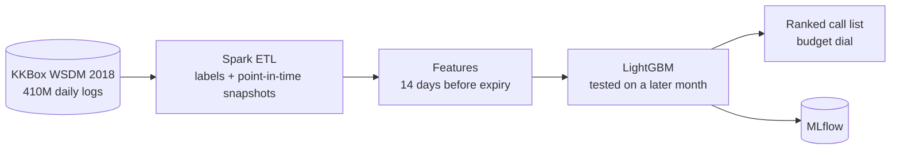

# Subscription Churn at Scale

Warn a retention team **before** renewal, rank who to call first, and show the trade-offs in plain numbers. Built on ~410 million daily listening records from the public KKBox (WSDM Cup 2018) dataset.

**Showcase page (interactive, every chart hoverable):** https://sabrinapribadi.github.io/subscription-churn-at-scale/

   

## Results at a glance

Test: March 2017, 862,158 members, 62,616 churners, official benchmark labels. Model trained on February.

| Question | Answer |
|---|---|
| Call the top 10% two weeks before renewal: how many churners do we reach? | **65%** (today's rule: 54%) |
| Of 100 calls, how many reach a real churner? | **48** (rule: 39, random: 7) |
| Extra churners reached each month, same number of calls | **+7,100** |
| What does more warning time cost? | 7 days: 68% · 14 days: 65% · 30 days: 60% reached |
| How much listening history is needed? | **30 days** — 30 to 180 days score the same |
| Do listening habits improve the list? | **No** (+0.004 vs a +0.02 bar). They do give 5 personas, e.g. silent payers: 20% of members, list reaches 36% of their churners |

Churner: a member who does not renew within 30 days after their membership expires.

## Phases

| Phase | Question | Gate (set before training) | Result |
|---|---|---|---|
| P0 · Labels | Can we rebuild the official labels? | ≥ 99% agreement | **Failed** (98.8% / 97.0%) — cause found; official labels used as test truth |
| P1 · Baseline | Does a model beat today's rule? | Out-of-time score reported; leakage tests pass | **Passed** — PR-AUC 0.568 vs rule 0.342 |
| P2 · Timing | How early can we call? How much history? | Curve and knee per lead time | **Passed** — lead time costs, history does not |
| P3 · Behaviour | Do listening habits help, esp. auto-renew cancellers? | +0.02 PR-AUC | **Failed** — best +0.004; kept as 5 personas for messaging |
| P4 · Call list | Who to call first, given revenue at risk? | Profit in top 10% beats probability sort | Planned |
| P5 · Services + GenAI | Can apps and agents use it? | Contract tests + LLM eval in CI | Planned |
| P6 · Databricks | Does it run on a real platform? | Same metrics on Databricks | Planned |

## How it works



1. **Labels** — the organiser's labeller, ported to Spark and unit-tested rule by rule.
2. **Snapshot** — every feature uses only data dated before *expiry − k days*; a test fails on any leak.
3. **Validation** — train on earlier months, test on a later one; never random rows.
4. **Reporting** — practitioner numbers first; ML metrics (PR-AUC, Gini, lift, H-measure, Brier, EMPC) in an appendix.

Decisions and the alternatives rejected: [docs/adr/](docs/adr/README.md). Change history in STAR format: [CHANGELOG.md](CHANGELOG.md).

## Run it

Python 3.12, Java 17 (`brew install openjdk@17`), ~60 GB free disk. Raw data stays outside the repo (`~/data/kkbox`).

```bash
pip install pyspark==4.0.* lightgbm pandas pyarrow scikit-learn mlflow pyyaml pytest empulse hmeasure
kaggle competitions download kkbox-churn-prediction-challenge -p ~/data/kkbox/raw   # accept the rules first
python scripts/convert_to_parquet.py --tables members transactions
python scripts/stream_user_logs_to_parquet.py          # 7z → Parquet without extracting 30 GB of CSV
python scripts/validate_labels.py                      # P0
python scripts/build_dataset.py --months 201611 201612 201701 201702 201703 && python scripts/train_model.py   # P1
python scripts/practitioner_report.py
for k in 0 7 14 30; do python scripts/build_dataset.py --k $k --windows 30 60 90 120 180 --months 201702 201703; done
python scripts/window_curve.py                         # P2
pytest tests/ -q
```

## Data

WSDM Cup 2018 — KKBox's Churn Prediction Challenge (Kaggle). Used under the competition's data terms; the data is not redistributed here. Only small aggregated results are committed (`data/outputs/`).
