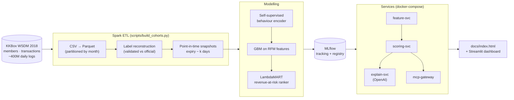

# Subscription Churn at Scale

> Who leaves, when, why — and who to call first. A Spark-scale churn system that predicts *before* renewal, ranks members by revenue at risk, and serves explanations to apps and AI agents.

**Status:** Design (PRD v0.1) — no results yet. Sections marked *pending* are filled in as each phase clears its gate.

## Why This Project

A subscription business usually learns a member has left only after the renewal date passes. The public WSDM Cup 2018 framing predicts churn *at* expiry — too late to act. This project reframes the task to predict **k days before expiry**, measures how much history the model really needs, tests whether **self-supervised behavioural embeddings** add signal beyond classic RFM features, and replaces "sort by probability" with a **LambdaMART ranking by revenue at risk**.

Research questions (each with a pre-registered gate, see [ADR-002](docs/adr/ADR-002-validation-strategy.md)):
1. How much lead time can we buy before accuracy collapses?
2. How long an observation window is enough for this design?
3. Do behavioural embeddings beat hand-crafted features out-of-time?
4. Does a revenue-aware ranker capture more profit in the top 10% than a probability sort?

## System Architecture



## Model Performance

*Pending — reported per phase, newest first, including negative results.*

## Architecture Decision Records

See [docs/adr/README.md](docs/adr/README.md).

## Project Structure

```
subscription-churn-at-scale/
├── configs/default_config.yaml   # all knobs; ADR references in comments
├── docs/                         # PRD, ADRs, ARCHITECTURE, lessons-learned, index.html
├── scripts/                      # download, build_cohorts, train, export
├── src/
│   ├── data/        features/    models/     ranking/    evaluation/
│   ├── genai/       # provider interface, prompt registry, tool registry
│   ├── mcp/         # MCP server reusing the tool registry
│   ├── services/    # feature-svc, scoring-svc, explain-svc
│   └── ui/          # Streamlit dashboard (reads pre-computed outputs)
├── tests/
└── CHANGELOG.md                  # STAR-format change log
```

## Setup

Python 3.12, PySpark 4.0, Java 17 (`brew install openjdk@17`). Raw data lives outside the repo at `~/data/kkbox/` (configurable in `configs/default_config.yaml`).

```bash
kaggle competitions download kkbox-churn-prediction-challenge -p ~/data/kkbox/raw   # accept rules first
python scripts/convert_to_parquet.py
pytest tests/ -q
```

## Data Source

WSDM Cup 2018 — KKBox Churn Prediction Challenge (Kaggle). Used under the competition's data terms; data is not redistributed in this repository.
