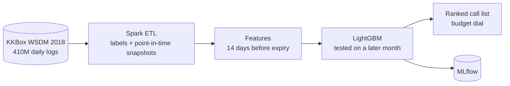

# Subscription Churn at Scale

<!-- brief:start -->

## For hiring teams: the project in 5W1H

1. **What:** A churn early warning for a music-subscription retention team: risk, reasons, who to call first, and a planning agent.
2. **Why:** Churn shows only after renewal fails; a warning 14 days earlier lets the team act. Today's rule calls only manual renewers.
3. **Who:** Users: retention managers and call agents.
   - Data: public KKBox (WSDM Cup 2018), 410M listening records, 6.8M members. Churner: no renewal within 30 days of expiry.
4. **Where:** [Results page](https://sabrinapribadi.github.io/subscription-churn-at-scale/) and [technical walkthrough](https://sabrinapribadi.github.io/subscription-churn-at-scale/build.html) on GitHub Pages; monthly job, registry and dashboard on Databricks; [demo API and MCP](https://subscription-churn-at-scale.vercel.app/docs) on Vercel.
5. **When it fails:** 8 phases with pass bars set before training; 3 failed and are reported (label rebuild, listening embeddings, learned ranker).
   - No live A/B test: historical data only. Tests are out-of-time (train February, score March); a live call test is the next step.
6. **How:** LightGBM on point-in-time features, calibrated, ranked by churn chance × member value; 5 alternatives tried and rejected.
   - Result: calling the top 10% reaches 65% of churners, vs 54% for today's rule; worth ≈12.4M a month after call costs.

**Skills applied** (each linked to the file or decision that shows it):

- **Big data engineering:** PySpark ETL over 410M rows, point-in-time features, no future data — [src/features/build.py](src/features/build.py), [ADR-001](docs/adr/ADR-001-task-framing.md)
- **Machine learning:** LightGBM, LambdaMART ranking, self-supervised sequence encoders — [ADR-003](docs/adr/ADR-003-behaviour-encoder.md), [ADR-004](docs/adr/ADR-004-ranking-and-calibration.md)
- **Statistics and evaluation:** out-of-time split, PR-AUC, calibration error, profit curves, label-shift correction — [ADR-002](docs/adr/ADR-002-validation-strategy.md), [ADR-004](docs/adr/ADR-004-ranking-and-calibration.md)
- **MLOps and CI/CD:** MLflow and Unity Catalog registry, PSI drift, dashboard as code, gated CI/CD with provenance — [ADR-009](docs/adr/ADR-009-monitoring-and-operations.md), [ci.yml](.github/workflows/ci.yml)
- **Cloud and services:** Databricks bundle job, four FastAPI services in Docker, demo API on Vercel — [ADR-005](docs/adr/ADR-005-service-boundaries.md), [ADR-008](docs/adr/ADR-008-databricks-port.md), [ADR-010](docs/adr/ADR-010-public-demo-api.md)
- **GenAI and agents:** grounded notes with a grader, a planning agent (42 of 45 unseen questions), MCP tools — [ADR-006](docs/adr/ADR-006-genai-module.md), [ADR-007](docs/adr/ADR-007-retention-planner-agent.md)
- **Domain:** subscription retention (churner definition, call lists, member value) — [ADR-001](docs/adr/ADR-001-task-framing.md)

<!-- brief:end -->

[](https://github.com/sabrinapribadi/subscription-churn-at-scale/actions/workflows/ci.yml)

   

## Results at a glance

Test: March 2017, 862,158 members, 62,616 churners, official benchmark labels. Model trained on February.

| Question | Answer |
|---|---|
| Of 100 calls, how many reach a real churner? | **48** (rule: 39, random: 7) |
| Extra churners reached each month, same number of calls | **+7,100** |
| What does more warning time cost? | 7 days: 68% · 14 days: 65% · 30 days: 60% reached |
| How much listening history is needed? | **30 days** — 30 to 180 days score the same |
| Do listening habits improve the list? | **No** (+0.004 vs a +0.02 bar). They do give 5 personas, e.g. silent payers: 20% of members, list reaches 36% of their churners |

## Phases

| Phase | Question | Gate (set before training) | Result |
|---|---|---|---|
| P0 · Labels | Can we rebuild the official labels? | ≥ 99% agreement | **Failed** (98.8% / 97.0%) — cause found; official labels used as test truth |
| P1 · Baseline | Does a model beat today's rule? | Out-of-time score reported; leakage tests pass | **Passed** — PR-AUC 0.568 vs rule 0.342 |
| P2 · Timing | How early can we call? How much history? | Curve and knee per lead time | **Passed** — lead time costs, history does not |
| P3 · Behaviour | Do listening habits help, esp. auto-renew cancellers? | +0.02 PR-AUC | **Failed** — best +0.004; kept as 5 personas for messaging |
| P4 · Call list | Who to call first, given revenue at risk? | LambdaMART profit beats probability sort; ECE ≤ 0.010 | **Failed** — LambdaMART −22%; probability × value wins all 9 scenarios (+0.2%) and is adopted |
| P5 · Services + GenAI | Can apps and agents use it? | Contract tests + LLM eval in CI | **Passed** — 4 services + MCP gateway; notes 100% grounded (60/60 live on OpenAI, 48 real members); $0.05 per 1,000 AI notes; planning agent 45/45 live test runs at $0.22 per 1,000 questions |
| P6 · Databricks | Does it run on a real platform? | Same metrics on Databricks | **Passed** — identical to the local run (PR-AUC 0.5594, profit 12,431,437); model registered in Unity Catalog as `champion`. Run 1 failed and exposed three determinism bugs, now fixed and tested |
| P7 · Operations | Can the team run it monthly? | Dashboard = scores table; drift for every input; held-out agent ≥ 80% | **Passed** — dashboard deployed by the bundle; drift: 2 alerts explained (short February), score stable; held-out agent questions 42/45 |

## How it works



1. **Labels** — the organiser's labeller, ported to Spark and unit-tested rule by rule.
2. **Snapshot** — every feature uses only data dated before *expiry − k days*; a test fails on any leak.
3. **Validation** — train on earlier months, test on a later one; never random rows.
4. **Reporting** — practitioner numbers first; ML metrics (PR-AUC, Gini, lift, H-measure, Brier, EMPC) in an appendix.

Decisions and the alternatives rejected: [docs/adr/](docs/adr/README.md). Change history in STAR format: [CHANGELOG.md](CHANGELOG.md).

## Run it

Python 3.12, Java 17 (`brew install openjdk@17`), ~60 GB free disk. Raw data stays outside the repo (`~/data/kkbox`).

```bash
pip install pyspark==4.0.* lightgbm pandas pyarrow scikit-learn mlflow pyyaml pytest empulse hmeasure
kaggle competitions download kkbox-churn-prediction-challenge -p ~/data/kkbox/raw   # accept the rules first
python scripts/convert_to_parquet.py --tables members transactions
python scripts/stream_user_logs_to_parquet.py          # 7z → Parquet without extracting 30 GB of CSV
python scripts/validate_labels.py                      # P0
python scripts/build_dataset.py --months 201611 201612 201701 201702 201703 && python scripts/train_model.py   # P1
python scripts/practitioner_report.py
for k in 0 7 14 30; do python scripts/build_dataset.py --k $k --windows 30 60 90 120 180 --months 201702 201703; done
python scripts/window_curve.py                         # P2
pytest tests/ -q
```

## Try it: live demo API and MCP

| Surface | Address | What it serves |
|---|---|---|
| REST API with interactive docs | [subscription-churn-at-scale.vercel.app/docs](https://subscription-churn-at-scale.vercel.app/docs) | Call-list totals and what-ifs for the real cohort; risk and notes for 100 demo members |
| MCP endpoint (stateless, spec 2026-07-28) | `https://subscription-churn-at-scale.vercel.app/mcp` | The same four tools for AI assistants |

- **No member data:** totals are the real cohort's; `demo-001` to `demo-100` are synthetic members scored by the real model (competition terms, ADR-010).
- Read-only: notes were written once offline; no LLM key on the host; the planning agent runs locally only.
- Connect an assistant: `claude mcp add --transport http churn https://subscription-churn-at-scale.vercel.app/mcp`.

**Free-tier limits (R20; Vercel Hobby, read 2026-11-11):**
- Free and non-commercial; each call gets up to 2 GB, 1 vCPU and 300 s.
- A monthly allotment; Hobby has no billing, so Vercel pauses the project instead of charging.
- After idle time the first call wakes the app: about 1–3 s (measured 2026-11-11).
- **Fallback:** the [results page](https://sabrinapribadi.github.io/subscription-churn-at-scale/) is static and carries every number, even if the API is paused.

## Use it: services and AI assistants

```bash
python scripts/export_serving_artifacts.py                     # model + calibration + scored cohort → ~/data/kkbox/serving
SERVICE=scoring SERVING_DIR=~/data/kkbox/serving uvicorn src.services.apps:app --port 8002
SERVING_DIR=~/data/kkbox/serving python -m src.gateway.mcp_server   # MCP over stdio for an AI assistant
SERVING_DIR_HOST=~/data/kkbox/serving docker compose up --build    # all four services
python scripts/llm_eval.py                                     # grounding, cost and latency report
python scripts/agent_eval.py --repeats 3                       # planner agent, live (needs OPENAI_API_KEY)
```

- **Ask in plain words:** `POST /ask` on explain-svc runs the planner agent (ADR-007).
- The agent picks the tools; every number in its answer must come from a tool result.

## Run it on Databricks (Free Edition)

```bash
databricks auth login --host <your workspace URL> --profile portfolio
databricks bundle deploy -p portfolio        # job definition: databricks.yml
databricks bundle run churn_p6 -p portfolio  # features (PySpark) → retrain + parity check + registry → tables
```

- **Inputs:** the Unity Catalog volume `workspace.churn.raw` (ADR-008).
- **Tables:** `features_k14_w30`, `scores_march_2017` and `drift_psi` in `workspace.churn`.
- **Model:** `workspace.churn.churn_lgbm@champion`.
- **Dashboard:** *Churn: monthly call list and model health*, deployed by the same bundle.
- **Schedule:** monthly, defined but paused (Free Edition quota).

| Tool (MCP) | Answers |
|---|---|
| `member_risk` | Calibrated churn probability, member value, call-list rank |
| `why_at_risk` | Plain-language note, checked against the model's facts, plus one suggested action |
| `call_list` | Top members by expected value at risk, with expected churners and profit |
| `what_if` | Best share to call for any save rate and cost per call |

- An OpenAI key in a local `.env` (never committed) switches notes from the template to `gpt-6-luna`.
- Every note is still graded; a note that invents anything falls back to the template.

## Data

- **Source:** WSDM Cup 2018 — KKBox's Churn Prediction Challenge (Kaggle).
- **Terms:** used under the competition's data terms; the data is not redistributed here.
- **Committed:** only small aggregated results (`data/outputs/`).
